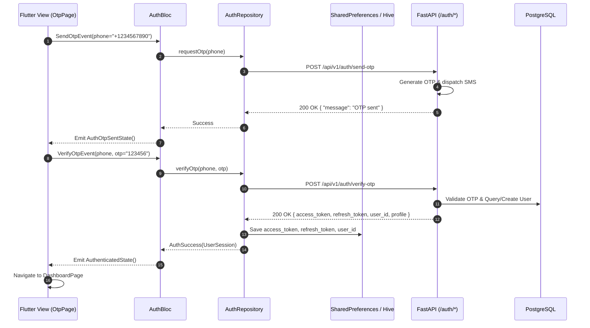
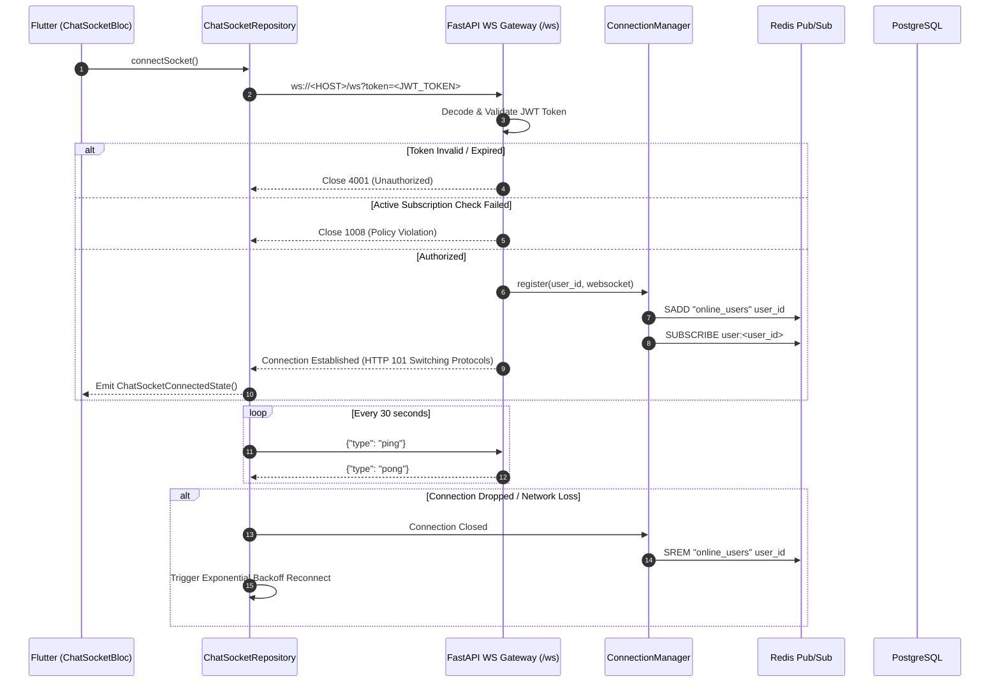
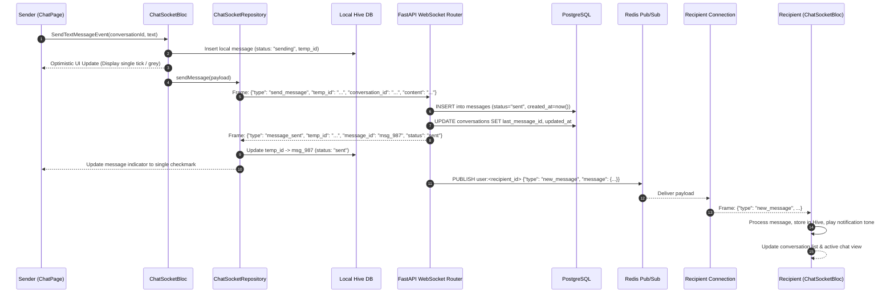
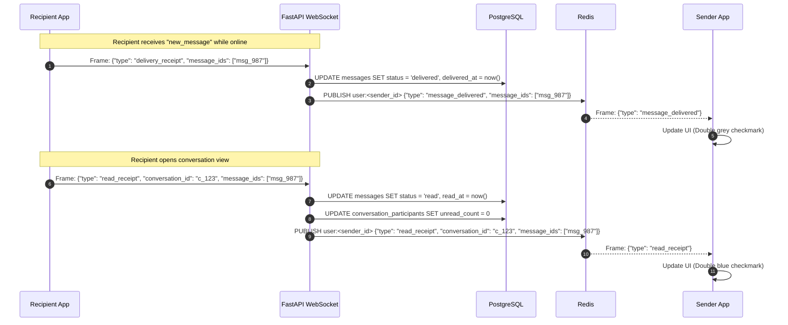
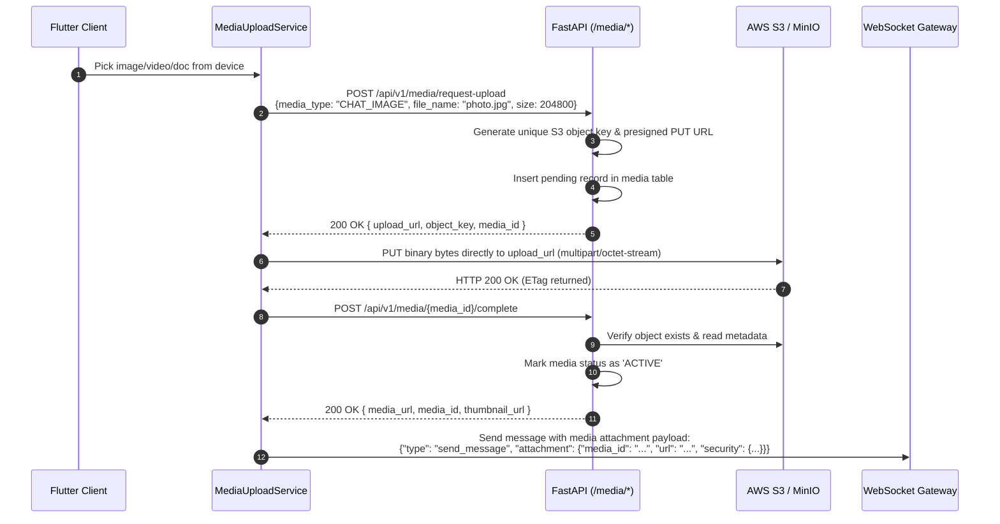
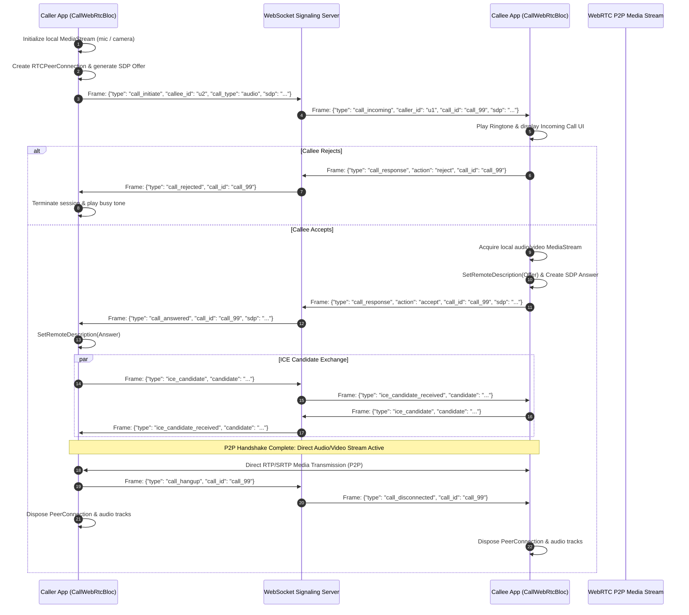
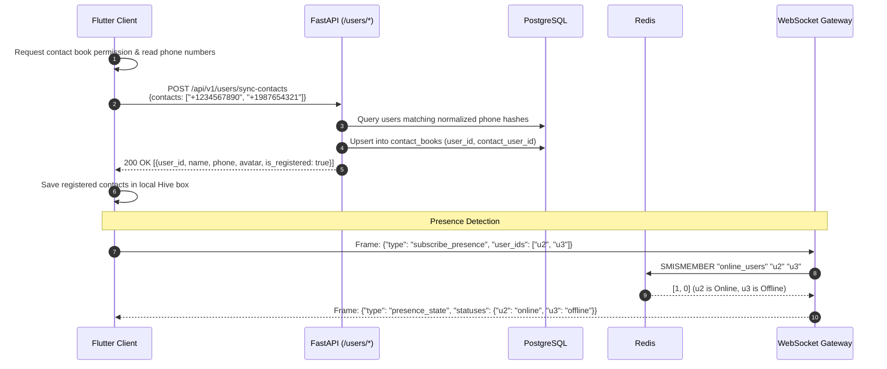
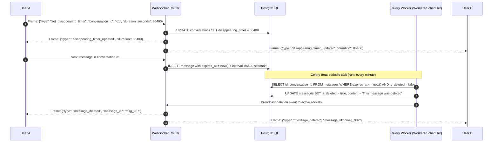
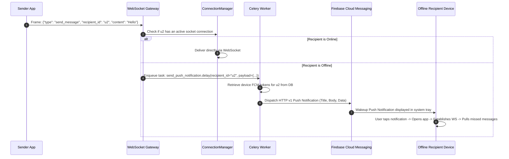
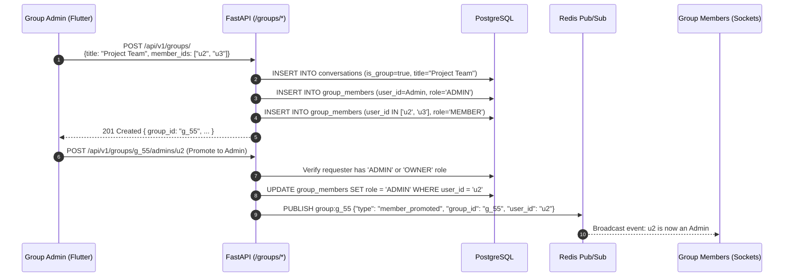

# 🔄 SChat End-to-End Control Flow Architecture (Frontend & Backend)

This document provides a comprehensive blueprint of the control flow across the **SChat** ecosystem, detailing the end-to-end interactions between the **Flutter Client (Frontend)** and the **FastAPI Modular Monolith (Backend)**.

---

## 📑 Table of Contents
1. [System Topology & Architectural Overview](#1-system-topology--architectural-overview)
2. [Layer-by-Layer Execution Model](#2-layer-by-layer-execution-model)
3. [End-to-End Control Flows](#3-end-to-end-control-flows)
   - [Flow 1: App Bootstrapping & OTP Authentication](#flow-1-app-bootstrapping--otp-authentication)
   - [Flow 2: Real-time WebSocket Gateway & Connection Lifecycle](#flow-2-real-time-websocket-gateway--connection-lifecycle)
   - [Flow 3: Real-time Messaging (Send, Persist, Fanout)](#flow-3-real-time-messaging-send-persist-fanout)
   - [Flow 4: Message Delivery & Read Receipts Lifecycle](#flow-4-message-delivery--read-receipts-lifecycle)
   - [Flow 5: Media Upload & S3 Presigned URL Pipeline](#flow-5-media-upload--s3-presigned-url-pipeline)
   - [Flow 6: WebRTC Calling Signaling & Media Negotiation](#flow-6-webrtc-calling-signaling--media-negotiation)
   - [Flow 7: Contact Synchronization & Presence Detection](#flow-7-contact-synchronization--presence-detection)
   - [Flow 8: Disappearing Messages & Background TTL Expiry](#flow-8-disappearing-messages--background-ttl-expiry)
   - [Flow 9: Offline Push Notifications via FCM & Celery](#flow-9-offline-push-notifications-via-fcm--celery)
   - [Flow 10: Group Management & Access Control (RBAC)](#flow-10-group-management--access-control-rbac)
4. [Cross-Layer Component Mapping Matrix](#4-cross-layer-component-mapping-matrix)
5. [Protocol & Payload Specifications](#5-protocol--payload-specifications)

---

## 1. System Topology & Architectural Overview

The SChat platform utilizes a decoupled, real-time client-server architecture:

```
┌────────────────────────────────────────────────────────────────────────────────────────┐
│                                 FLUTTER CLIENT (FRONTEND)                              │
│  ┌───────────────────────┐   ┌──────────────────────┐   ┌───────────────────────────┐  │
│  │   UI Views / Widgets  │──>│  BLoC State Machine  │──>│ Repositories & Services   │  │
│  └───────────────────────┘   └──────────────────────┘   └───────────────────────────┘  │
│                                                               │            │           │
│                                         REST API (Dio) ───────┘            │ WebSockets│
└───────────────────────────────────────────────┬────────────────────────────┼───────────┘
                                                │                            │
                                                ▼                            ▼
┌────────────────────────────────────────────────────────────────────────────────────────┐
│                                 FASTAPI SERVER (BACKEND)                               │
│  ┌───────────────────────────┐                       ┌──────────────────────────────┐  │
│  │  REST Routers (app/api)   │                       │  WebSocket Gateway / Manager │  │
│  └─────────────┬─────────────┘                       └──────────────┬───────────────┘  │
│                │                                                    │                  │
│                ▼                                                    ▼                  │
│  ┌───────────────────────────┐                       ┌──────────────────────────────┐  │
│  │  Services & Dependencies  │                       │   Redis Pub/Sub Fanout Bus   │  │
│  └─────────────┬─────────────┘                       └──────────────┬───────────────┘  │
│                │                                                    │                  │
│                ▼                                                    │                  │
│  ┌───────────────────────────┐                                      │                  │
│  │ SQLAlchemy 2.0 Async ORM  │                                      │                  │
│  └─────────────┬─────────────┘                                      │                  │
└────────────────┼────────────────────────────────────────────────────┼──────────────────┘
                 │                                                    │
                 ▼                                                    ▼
┌─────────────────────────────────┐   ┌───────────────────┐   ┌──────────────────────────┐
│   PostgreSQL 15 (Relational DB) │   │ Redis 7.0 (Cache) │   │ Celery Workers + FCM     │
└─────────────────────────────────┘   └───────────────────┘   └──────────────────────────┘
```

---

## 2. Layer-by-Layer Execution Model

### Frontend (Flutter Client)
* **Presentation Layer**: Flutter Widgets observe state emissions via `BlocBuilder` and `BlocListener`. User interactions dispatch Events into feature BLoCs (`AuthBloc`, `ChatSocketBloc`, `CallWebRtcBloc`, `ChatBloc`).
* **Domain Layer**: Clean Architecture boundaries defining pure models (`ChatSocketModel`, `MessageEntity`), abstract repository contracts, and isolated UseCases.
* **Data Layer**:
  * **HTTP Client**: `Dio` configured with `ApiInterceptor` (`lib/core/network/api_interceptor.dart`) automatically injecting `Authorization: Bearer <Token>`.
  * **Realtime Sockets**: `IWebSocketService` / `WebSocketChannel` maintaining active connection, dispatching message streams to `ChatSocketRepository`.
  * **Calling**: `WebRtcService` wrapper around `flutter_webrtc` managing `RTCPeerConnection`, `MediaStream`, and SDP negotiations.
  * **Local Persistence**: `StorageService` (`shared_preferences`) for session tokens and flags; `Hive` for offline messages, contacts, and security rules.

### Backend (FastAPI Monolith)
* **API Ingress**: FastAPI application with CORS middleware, JWT security interceptors, and typed Pydantic v2 schemas.
* **WebSocket Ingress**: `app/websocket/router.py` authenticates via query token (`?token=...`), handles bidirectional JSON envelopes, and delegates to `ConnectionManager`.
* **Database & Persistence**: `asyncpg` engine driving async SQLAlchemy sessions. Unit of Work pattern managed via FastAPI `Depends(get_db)`.
* **Distributed Coordination**:
  * **Redis**: In-memory pub/sub message distribution across horizontal server instances and user presence tracking.
  * **Celery**: Background asynchronous tasks (delayed message deletion, offline push notifications, thumbnail generation).

---

## 3. End-to-End Control Flows

---

### Flow 1: App Bootstrapping & OTP Authentication

Controls client launch, local token check, phone number verification, and session bootstrap.



**Control Steps:**
1. **App Startup**: `SplashScreen` reads `StorageService.getAccessToken()`. If absent, redirects to `PhoneNumberPage`.
2. **Send OTP**: User submits phone number. `AuthBloc` executes `POST /auth/send-otp`.
3. **Verification**: User inputs code. `POST /auth/verify-otp` validates against DB.
4. **Token Persistence**: JWT tokens (`access_token`, `refresh_token`), `user_id`, and `device_id` are stored locally in `SharedPreferences`.
5. **Dependency Injection Update**: `ApiInterceptor` reads stored token for subsequent HTTP requests; WebSocket client attaches token in handshake.

---

### Flow 2: Real-time WebSocket Gateway & Connection Lifecycle

Handles connection establishment, authentication guard, subscription entitlement check, and heartbeat keepalive.



---

### Flow 3: Real-time Messaging (Send, Persist, Fanout)

Traces the path of a text message from sender keystroke to optimistic local rendering, WebSocket dispatch, backend persistence, Redis relay, and recipient receipt.



---

### Flow 4: Message Delivery & Read Receipts Lifecycle

Controls real-time message status transitions: `sending` ➔ `sent` ➔ `delivered` ➔ `read`.



---

### Flow 5: Media Upload & S3 Presigned URL Pipeline

Binary attachments bypass WebSockets to ensure high throughput, zero memory bottlenecks on the socket server, and secure direct-to-S3 storage.



---

### Flow 6: WebRTC Calling Signaling & Media Negotiation

The WebSocket gateway acts as the signaling channel for SDP exchange, while audio/video media streams flow peer-to-peer (or via LiveKit SFU).



---

### Flow 7: Contact Synchronization & Presence Detection



---

### Flow 8: Disappearing Messages & Background TTL Expiry



---

### Flow 9: Offline Push Notifications via FCM & Celery



---

### Flow 10: Group Management & Access Control (RBAC)



---

## 4. Cross-Layer Component Mapping Matrix

| Functional Module | Frontend Component (`lib/`) | Backend Router (`app/`) | Service / Worker Layer | Persistence / Broker |
| :--- | :--- | :--- | :--- | :--- |
| **Authentication & OTP** | `features/auth_screen/`<br>`AuthBloc`, `AuthRepository` | `app/auth/router.py`<br>`/api/v1/auth/*` | `app/auth/service.py`<br>SMS gateway provider | PostgreSQL `users`, `otps`<br>`StorageService` (Tokens) |
| **User Profile & Contacts**| `features/profile_screen/`<br>`ProfileBloc` | `app/users/router.py`<br>`/api/v1/users/*` | `app/users/service.py` | PostgreSQL `users`, `contact_books`<br>Hive `contacts_box` |
| **Realtime Messaging** | `features/chat_socket_screen/`<br>`ChatSocketBloc`, `ChatSocketRepository` | `app/websocket/router.py`<br>`/ws` | `app/websocket/manager.py`<br>`ConnectionManager` | PostgreSQL `messages`<br>Redis Pub/Sub, Hive DB |
| **Conversations & Groups** | `features/chat_screen/`<br>`ChatBloc`, `ChatRepository` | `app/chats/router.py`<br>`app/groups/router.py` | `app/chats/service.py`<br>`app/groups/service.py` | PostgreSQL `conversations`, `group_members` |
| **Media Attachments** | `services/media_upload_service.dart` | `app/media/router.py`<br>`/api/v1/media/*` | `app/media/service.py`<br>Boto3 S3 Client | AWS S3 / MinIO<br>PostgreSQL `media` |
| **WebRTC Audio/Video Calls**| `features/call_screen/`<br>`CallWebRtcBloc`, `WebRtcService` | `app/websocket/router.py`<br>`app/calls/router.py` | Signaling handler<br>`LiveKit SFU Service` | Redis call sessions<br>PostgreSQL `call_logs` |
| **Background Auto-Delete** | Timer triggers in `ChatPage` | None (Worker scheduled) | `app/workers/tasks.py`<br>Celery Beat scheduler | PostgreSQL `messages` |
| **Push Notifications** | `services/notification_service.dart`<br>FCM SDK | `app/notifications/router.py`<br>`/api/v1/notifications/*` | Celery asynchronous worker<br>`firebase_admin` SDK | PostgreSQL `device_tokens`<br>FCM Gateway |
| **24h Status / Stories** | `features/status_screen/`<br>`StatusBloc` | `app/chats/status_router.py`<br>`/api/v1/statuses/*` | `app/chats/status_service.py` | PostgreSQL `statuses`<br>Redis temporary keys |
| **Subscriptions & Paywall**| `features/subscription_screen/`<br>`SubscriptionBloc` | `app/subscriptions/router.py`<br>`/api/v1/subscriptions/*` | `app/subscriptions/service.py` | PostgreSQL `subscriptions`, `plans` |

---

## 5. Protocol & Payload Specifications

### WebSocket Envelope Standards

#### Outbound (Frontend ➔ Backend)
```json
{
  "type": "send_message",
  "temp_id": "uuid-v4-generated-by-client",
  "conversation_id": "uuid-of-conversation",
  "content": "Encrypted or plain string",
  "reply_to_message_id": null,
  "attachment": {
    "media_id": "media-record-uuid",
    "url": "https://s3.amazonaws.com/...",
    "type": "CHAT_IMAGE",
    "security": {
      "isLocked": false,
      "accessUsers": [],
      "allowDownload": true,
      "allowShare": true
    },
    "viewControl": {
      "type": "once",
      "maxViews": 1
    }
  }
}
```

#### Inbound (Backend ➔ Frontend)
```json
{
  "type": "new_message",
  "message": {
    "id": "msg_01J...",
    "temp_id": "uuid-v4-generated-by-client",
    "conversation_id": "c_...",
    "sender_id": "u_...",
    "content": "Hello world",
    "status": "sent",
    "created_at": "2026-10-12T08:30:00Z",
    "attachment": null,
    "security": {}
  }
}
```

#### Status Receipts
```json
// Delivered receipt
{
  "type": "delivery_receipt",
  "message_ids": ["msg_01J..."]
}

// Read receipt
{
  "type": "read_receipt",
  "conversation_id": "c_...",
  "message_ids": ["msg_01J..."]
}
```

---

## 🛡️ Resilience & Failure Modes

1. **Network Disconnection**:
   - The Flutter client's `ChatSocketRepository` activates an exponential backoff retry policy (1s, 2s, 5s, 10s, up to 30s).
   - In-flight messages are held in Hive with status `"sending"` and re-flushed upon reconnection.
2. **WebSocket Fallback to FCM**:
   - When a message target is offline in Redis (`user:<id>` channel has no active subscribers), the message persists in PostgreSQL and is forwarded to Celery to generate an immediate Firebase Cloud Notification.
3. **Optimistic UI Reconciliation**:
   - Every sent message generates a local client UUID (`temp_id`). Once the server confirms insertion, it returns `{temp_id, message_id}` so the client can reconcile and update the local database entry without flicker or duplicated bubbles.
